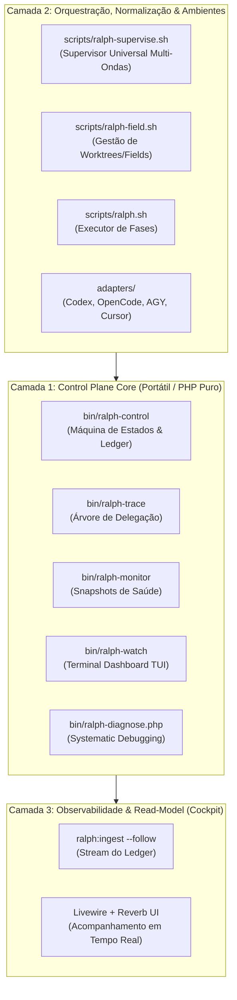

# Marco Canônico — Ralph Method 2.0

> **Versão do Marco**: 2.0  
> **Status**: Canônico / Autoridade Máxima de Arquitetura  
> **Escopo**: Control plane local, portátil e agnóstico para desenvolvimento autônomo baseado no protocolo SPP (Spec, Plan, Phases).

---

## 1. Visão Geral e Papel do Projeto

O **Ralph Method** é um control plane local, portátil e estritamente **agnóstico ao domínio da aplicação-alvo**. Ele governa a execução faseada de software, o enforcement de gates determinísticos, o systematic debugging read-only, a recuperação de falhas, a preservação de memória e a telemetria em tempo real.

O núcleo do framework não importa código de aplicação, não se conecta a bancos de dados de produto e não consome credenciais de serviços externos. O projeto-alvo fornece exclusivamente o seu contrato de fases (SPP), seus comandos mecânicos de validação e o seu contexto de engenharia.

---

## 2. Os Seis Invariantes Inegociáveis

Todo módulo, adaptador ou extensão do Ralph Method deve obedecer sem exceção aos 6 invariantes:

### Invariante 1 — Agnosticismo Radical
O Ralph Method não possui acoplamento com frameworks web (Laravel, Rails, Django, Next.js), linguagens específicas ou regras de negócio. Qualquer projeto dotado de um repositório Git e um contrato de testes é elegível para execução pelo Ralph Method.

### Invariante 2 — Autoridade Única do Ledger
O binário `bin/ralph-control` e o arquivo append-only `events.jsonl` são a autoridade absoluta e exclusiva sobre o estado da máquina de execução.
- Os adaptadores de provider (`adapters/`) apenas normalizam payloads; nunca gravam estado global.
- A interface gráfica (`apps/cockpit`) e o monitor (`bin/ralph-watch`) apenas projetam o read-model; nunca aprovam gates, nunca alteram leases e nunca decidem a próxima feature.

### Invariante 3 — Execução Sequencial e Anti-Paralelismo Estrito
O desenvolvimento autônomo de alta precisão requer determinismo:
- É expressamente proibida a execução concorrente de múltiplos executores sobre a mesma árvore de código.
- O orquestrador garante instância única via locks determinísticos (`.supervisor.lock` e `.supervisor-wrapper.lock`).
- A execução de múltiplas ondas (multi-ondas) ocorre estritamente em fila sequencial: a Onda $N+1$ só é iniciada quando a Onda $N$ estiver 100% liberada (`released`).

### Invariante 4 — Cinco Gates Mecânicos e Determinísticos
Nenhuma feature é aprovada por "fé", resumo textual ou inferência de LLM. A aprovação exige a comprovação física dos 5 gates de entrega:
1. **Gate 1 (Validation)**: integridade sintática e de schema dos artefatos.
2. **Gate 2 (Quality)**: suíte mecânica de testes do projeto (Sail, Composer, PHPUnit, Jest, Pytest, Go, Cargo).
3. **Gate 3 (Verification / Independent Review)**: validação estática adversarial read-only sem contaminação do runner.
4. **Gate 4 (Runtime Evidence)**: evidência viva de execução (processos ativos, status code de endpoints, integridade de container).
5. **Gate 5 (Handoff & Trace)**: registro do diff, auditoria de hashes e cadeia de custódia da delegação.

### Invariante 5 — Systematic Debugging com Context7
Quando ocorre uma falha mecânica de gate ou stall de execução:
- O supervisor veta retries cegos ou loops infinitos de tentativa e erro.
- Dispara-se o protocolo de **Systematic Debugging Read-Only**: formulação de hipóteses falsificáveis, isolamento determinístico da causa raiz, consulta a documentações canônicas oficiais (Context7) e produção de relatório diagnóstico (`report.json`).
- O circuito só é reaberto para implementação após a causa raiz estar mapeada e a lição aprendida estruturada.

### Invariante 6 — Coexistência Não-Invasiva (Overlay SPP)
O Ralph Method respeita harnesses pré-existentes no projeto-alvo (Claude CLI, Codex, OpenCode, bc-harness):
- Instalação cirúrgica e atômica sob `.ralph/` via manifesto de ownership (`.ralph/method.json`) e hashes SHA-256.
- Zero sobrescrita de scripts nativos de loop existentes.
- Desinstalação limpa e reversível (`ralph-init uninstall`), removendo exclusivamente os componentes do Ralph Method sem deixar resíduos.

---

## 3. Topologia Arquitetural em Três Camadas

---

## 4. O Ciclo SPP (Spec, Plan, Phases)

O orquestrador consome a estrutura canônica de especificação:

1. **Spec (`.spec/init/` ou `.spec/features/<slug>/SPEC.md`)**:
   - Definição do problema, limites de escopo (blast radius) e critérios de aceitação GEARS.
2. **Plan (`PLAN.md`)**:
   - Mapeamento técnico de componentes, dependências e arquitetura de entrega.
3. **Phases (`PHASES.md` ou `.phases/`)**:
   - Divisão atômica da demanda em fatias verticais autônomas (fases 1..N). Cada fase corresponde a um bloco controlado executado pelo runner e chancelado pelos 5 gates.

---

## 5. Ciclo de Vida de Campos Isolados (`.ralph/fields/`)

Para testes de carga, provas de fogo ou execuções que demandam isolamento estrito de filesystem e containers:
- O harness proíbe clones desordenados soltos na raiz do projeto.
- Todo ambiente isolado é criado via `scripts/ralph-field.sh create <nome>`.
- Os campos residem sob `.ralph/fields/<nome>/` e são blindados pelo `.gitignore`.
- O descarte é garantido por `scripts/ralph-field.sh destroy <nome>`, eliminando resíduos de disco e processos zumbis.

---

## 6. Governança e Validação Contínua

Toda e qualquer alteração no repositório do Ralph Method é submetida compulsoriamente a:
1. `bash scripts/check-shell.sh` — 100% de conformidade estática (ShellCheck e integridade de sintaxe).
2. `bash scripts/check-doc-sync.sh` — Sincronia formal de versão entre `VERSION`, `AGENT_GUIDE.md`, `STATUS.md` e `ralph-init`.
3. `bash scripts/test-ralph-supervise-unit.sh` — Validação comportamental do orquestrador universal.
4. `bash scripts/test-ralph-field-unit.sh` — Validação do gerenciador de campos.
5. Suíte de testes portáteis offline do núcleo, sem dependências de infraestrutura de terceiros.
