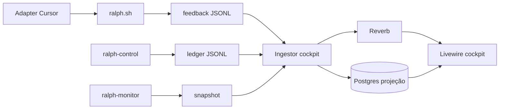

# Trace Cockpit — visibilidade ao vivo do Ralph Method

> **Versão**: 1.0.0
> **Status**: Aprovado para implementação nesta branch
> **Criado em**: 2026-08-16
> **Autor**: Ralph Method
> **Design**: [`docs/design/ralph-method-trace-design/`](../design/ralph-method-trace-design/)
> **Arquitetura**: [`docs/architecture/trace-cockpit.md`](../architecture/trace-cockpit.md)
> **ADR**: [`docs/adr/0022-cockpit-somente-leitura.md`](../adr/0022-cockpit-somente-leitura.md)

---

## Tese do produto

> Mostrar o Ralph em movimento, em tela, em tempo real — sem pedir relatório
> e sem dar à interface autoridade sobre gates, leases ou a escolha da fila.
> Disparar `supervise` só é permitido com preflight verde. Diagnosticar e
> retomar o orquestrador passam pelo `ralph-control` (debug/recover), nunca
> pela aprovação de gate.

## Hero flow

O operador abre o cockpit no browser. Vê o pulso, a próxima feature, os
cinco gates, a timeline e a árvore de delegação. Se o preflight estiver
verde, dispara **Rodar Ralph**; o `ralph-control` escolhe a feature e
corre o bloco. Se a fila estiver em `recovery_required` ou
`debugging_required`, **Diagnosticar** e **Retomar orquestrador** fazem
o systematic debugging e o recover no controlador, depois relançam o
supervise com o comando de debug. Se o diagnóstico confirmar que o
arquivo de plano declarado não existe, o preflight recusa novo disparo
até o checkout ser restaurado. Fecha o browser, reabre, e o estado
hidrata do read-model.

## 1. Problema

Hoje a visibilidade é CLI: `ralph-monitor`, `ralph-metrics`, handoff e
relatórios numerados. Quem acompanha a execução precisa pedir snapshot,
ler JSONL ou esperar o relatório. O canal de feedback (`ADR-0002`) já existe
para tela, mas não há superfície visual.

O mockup em `docs/design/ralph-method-trace-design/` já define o produto:
premium, somente leitura, três visões (Tudo / Eventos / Gates).

## 2. Público

Operador local do Ralph Method neste checkout (self-hosting) e, depois, em
qualquer projeto-alvo onde o método esteja instalado. Um operador, um
checkout, um browser. Sem multi-tenant nesta v1.

## 3. Fora de escopo (v1)

- Aprovar gate, renovar lease, retry, advance ou release pela UI.
  Recover e debug só existem para destravar o orquestrador via
  `ralph-control`, nunca para escolher a próxima feature.
  Iniciar o supervisor só via preflight (nunca escolher a feature na tela).
- Filament / CRUD administrativo.
- Auth, multi-usuário, multi-checkout simultâneo.
- Importar prompts, tokens, respostas ou logs brutos do provider.
- Testar o núcleo portátil com Laravel, Postgres ou Reverb.
- Portar o plugin `bc-harness` para dentro do método.

## 4. Critérios P0

- [ ] P0.1 — a UI não aprova, não faz retry/advance/release; rotas HTTP
      não expõem `recover`; as mutações permitidas são `ralph-control
      supervise` após preflight verde, `debug` com o diagnóstico read-only
      do cockpit, `recover` quando o cursor está travado, e SIGTERM no
      supervise que o cockpit iniciou.
- [ ] P0.2 — o hero flow atualiza ao vivo via Reverb a partir de fatos já
      publicados (feedback + ledger + snapshot do monitor).
- [ ] P0.3 — o visual reproduz o DNA de
      `Ralph Trace Cockpit.dc.html` (não o fallback Inter do HTML estático).
- [ ] P0.4 — `apps/cockpit/` fica isolado: `scripts/ci-portable.sh` não sobe
      Laravel, banco nem Reverb.
- [ ] P0.5 — o read-model é reconstruível a partir dos JSONL; o banco não é
      fonte de verdade.
- [ ] P0.6 — o `engine` exibido é o do evento (nesta branch o alvo operacional
      é `cursor`); a UI não escolhe provider.

## 5. Superfície v1 (do design)

| Bloco | Fonte canônica | Nota |
|---|---|---|
| Pulso / saúde | `ralph-monitor --once --json` | `health`, processos, heartbeat |
| Workflow + branch + progresso | workflow.json + monitor + feedback `progress.percent` | anel SVG do design |
| Feature atual + sequência | ledger + workflow | “sem avanço manual” |
| Cinco gates | ledger de gates | o 5º (Curation) não tem botão |
| Timeline | ledger `events.jsonl` ∪ feedback | fatos sanitizados |
| Visão Eventos | mesma timeline, filtro `events` | log denso |
| Visão Gates | gates por feature | board de 3 colunas |
| Memória | `ralph-knowledge` / candidatos | não bloqueante |
| Delegação | trace / ledger de delegação | root = `ralph-control` |

O schema `feedback-event.schema.json` sozinho **não** preenche o mockup
(não tem nome de gate, título de feature nem lições). O cockpit lê três
fontes; não alarga o schema de feedback para conceder autoridade extra.

## 6. Stack (decidida)

| Peça | Escolha v1 | Por quê |
|---|---|---|
| App | Laravel 13 + Livewire 4 + Tailwind 4 em `apps/cockpit/` | UI Laravel nativa, não Filament |
| Tempo real | Laravel Reverb + Echo | pedido explícito; um processo local |
| Banco | PostgreSQL (projeção) | hidratar reload; JSONL pode crescer |
| Fila | `database` | convenção Laravel; inspecionável |
| Runtime | Docker Compose no próprio `apps/cockpit/` | Sail-like; bind `127.0.0.1` |
| Runner observado | Cursor (`adapters/cursor/`) | pedido desta sessão; UI agnóstica |

## 7. Decisões

| Decisão | Owner | Registro |
|---|---|---|
| Cockpit é observador, nunca controlador | Ralph Method | ADR-0022 |
| App vive em `apps/cockpit/`, não no núcleo | Ralph Method | ADR-0022 |
| Postgres é projeção reconstruível | Ralph Method | ADR-0022 |
| Sem auth na v1; bind localhost | Ralph Method | esta PRD |
| Sem Filament na v1 | Ralph Method | DNA visual do design |
| Multi-checkout fica para depois | Ralph Method | `open-questions.md` |

## 8. Aceite

1. Com um bloco Cursor em execução, o cockpit mostra pulso, feature, gates e
   eventos novos em menos de 3 s após o JSONL ser gravado.
2. Recarregar a página reconstitui o mesmo estado a partir do banco, que pode
   ser apagado e reingestido dos arquivos.
3. Não existe botão, rota ou job que chame `approve`, `retry`, `recover`,
   `advance`, `release` ou equivalente.
4. `bash scripts/ci-portable.sh` continua verde sem Docker do cockpit.
